<p align="center">
  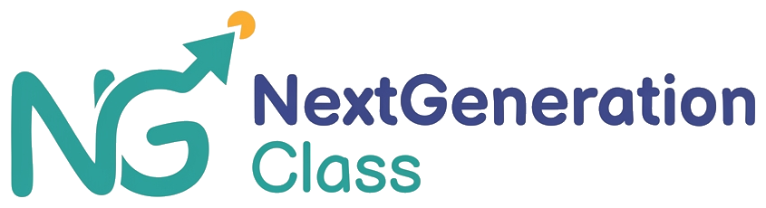
</p>

<p align="center"><em>Enseigner, suivre, progresser.</em></p>

<p align="center">
  A private teaching platform for primary school teachers in Tunisia, their pupils and the pupils' parents.<br>
  French and Arabic, on the web, Android and iOS.
</p>

<p align="center">
  
  
  
  
  
</p>

<p align="center">
  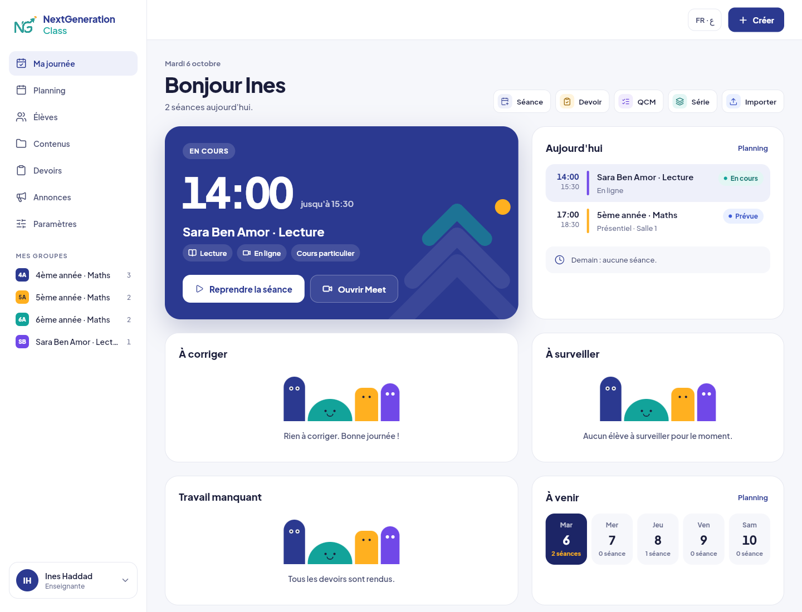
</p>

## What it is

NextGeneration Class is the one place a primary school teacher (1ère to 6ème année) runs their groups and private lessons. Each morning it shows what has to be done today. It keeps the planning and the attendance, stores and reuses the course material, sends homework, and puts every copy to correct in one queue. Pupils see their sessions, their work and their results. Parents get a one minute view of their child.

There is no marketplace and no payment. Running costs stay close to zero, and every feature works without AI.

## Who uses it

### The teacher

| Area | What it does |
|---|---|
| **Ma journée** | The session in progress with its Meet link, today's sessions, copies to correct, missing work and the week ahead. |
| **Planning** | Weekly series and one-off sessions, in class or online. Cancel or move a session with a reason and families are told. Session mode takes the attendance and shows the day's content. |
| **Élèves** | Groups and private lessons, pupils with their parents, an optional login for the child, a printable sheet of login details, private notes and an archive. Import a whole class from Excel or CSV. |
| **Contenus** | A library by subject, level and chapter. Import a PDF, a photo or a Word file, or scan paper sheets with the camera into one PDF (crop each corner, reorder the pages). Keep a document as a draft or publish it. |
| **Devoirs** | Give homework to a group or to some pupils and follow who sent it, who is late and who has not. Correct each copy page by page, with half points and a comment. |
| **Évaluations** | Paper tests typed in one table: Tab moves to the next pupil, Enter saves, an absent pupil never counts as 0. The averages update as you type. |
| **Everywhere** | A notification bell, a search across pupils, parents, groups, documents, homework and evaluations (Ctrl K or ⌘ K), and the teacher's own subjects in Paramètres. |

### The pupil

A home page that speaks to a child: what is new, the next session ("Demain, mercredi", "En classe · Salle 2"), and the week at a glance. Then the planning, the courses, the homework (sent straight from a phone) and the results.

### The parent

**Aperçu** answers "how is my child doing this week" in one screen: the average, the next session, attendance, homework handed in, the last grade and the teacher's latest note. Courses, homework, planning, results and notifications are one tap away.

### The owner

A small dashboard to add teachers, reset a password, and disable or enable an account. Each teacher works in a separate space. The owner sees accounts and counts, never a pupil's data.

## Screenshots

<table>
  <tr>
    <td width="50%">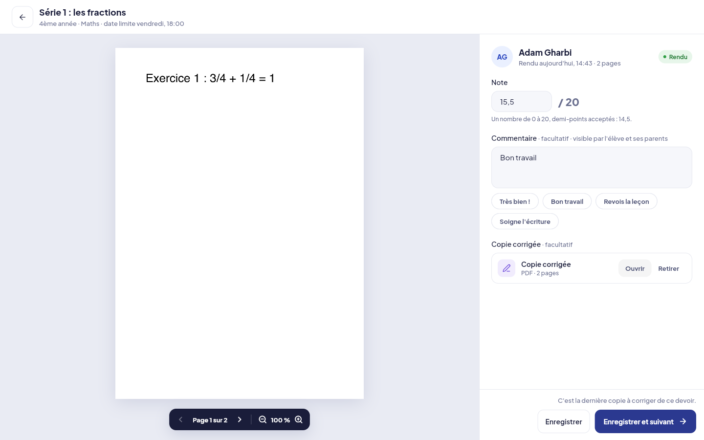<br><sub>Correcting a copy, page by page</sub></td>
    <td width="50%">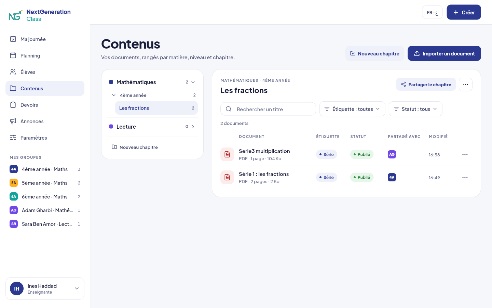<br><sub>The library by subject, level and chapter</sub></td>
  </tr>
  <tr>
    <td>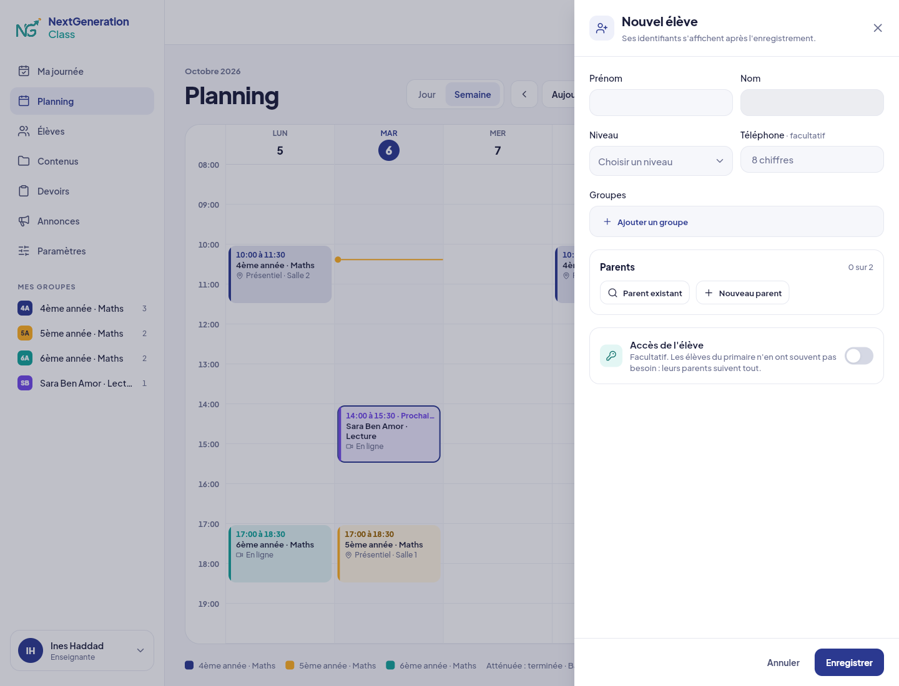<br><sub>The week's planning</sub></td>
    <td>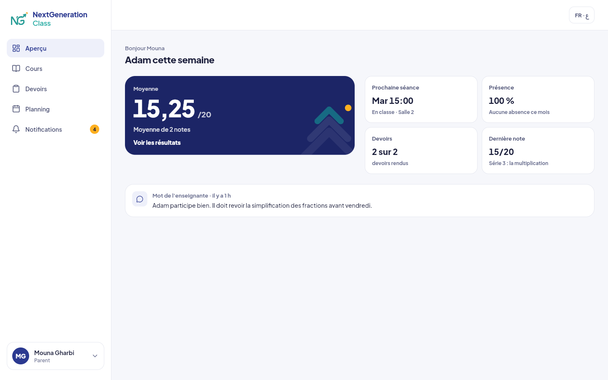<br><sub>The parent's Aperçu on a computer</sub></td>
  </tr>
  <tr>
    <td>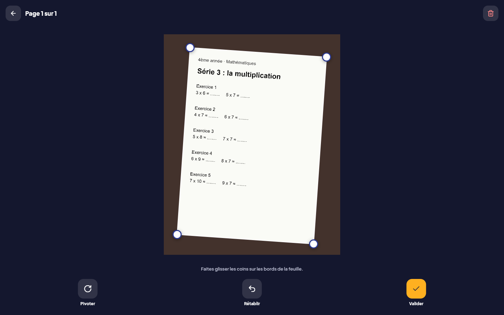<br><sub>Scanning a paper sheet and cropping it</sub></td>
    <td>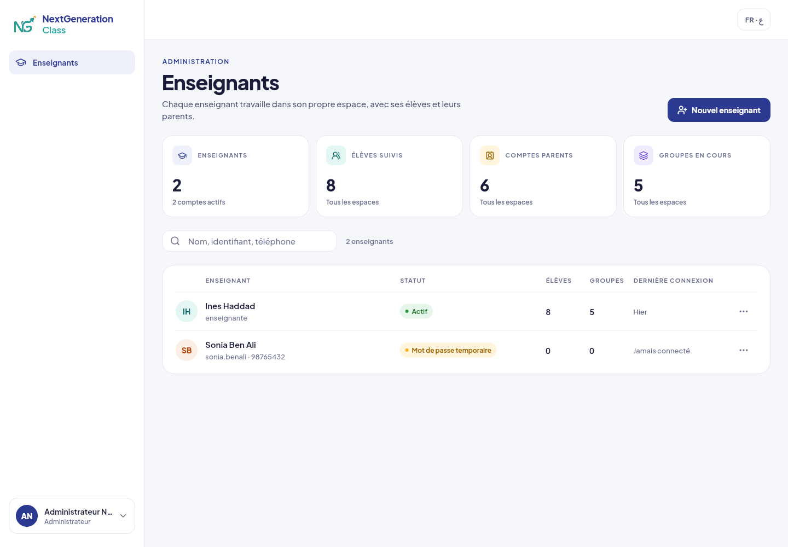<br><sub>The owner's dashboard</sub></td>
  </tr>
</table>

<p align="center">
  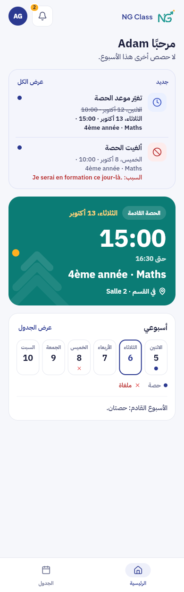
  &nbsp;
  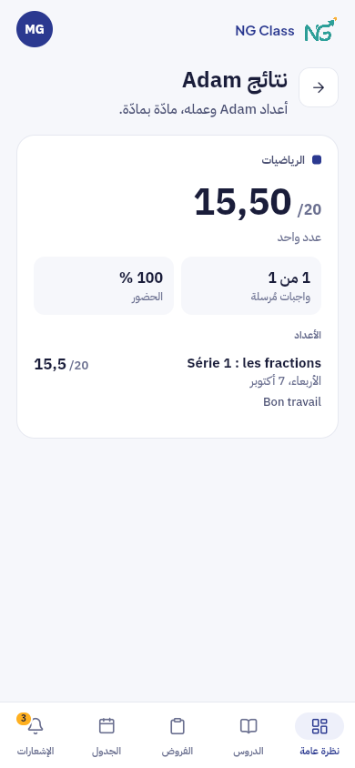
  &nbsp;
  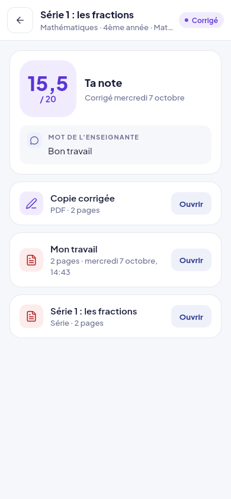
  <br>
  <sub>On a phone: the pupil's home and the parent's results in Arabic, a corrected homework in French</sub>
</p>

More screens, release by release: [docs/00-brand/ui/flutter](docs/00-brand/ui/flutter).

## Built for every screen and both languages

- **French and Arabic** in every screen. Arabic runs right to left with a directional layout throughout, Tunisian month names, and names and times that never get scrambled by the text direction.
- **Every size**, from a 320 px phone to a 1920 px desktop. `app/test/view/responsive_test.dart` opens each screen family at 9 sizes in both languages and fails on any overflow.
- **Designed first.** Every screen family was drawn as a mockup and approved before it was built ([docs/00-brand/ui](docs/00-brand/ui/README.md)).
- **Sessions that last.** A family signs in once and stays signed in for a year.

## Tech stack

| Layer | Choice |
|---|---|
| App | Flutter 3.38 (web, Android, iOS), Cubits (`flutter_bloc`), `go_router`, Dio, gen-l10n (FR and AR) |
| API | Spring Boot 3.5, Java 21, Spring Security with JWT, Spring Data JPA, Lombok |
| Database | PostgreSQL 16, migrations with Flyway |
| Files | `pdf` and `printing` for login sheets and scanned documents, `image` for the scan |
| Tests | `flutter_test`, `bloc_test`, `mocktail`; JUnit with MockMvc and Testcontainers on a real PostgreSQL |
| Hosting | Docker Compose, Caddy for HTTPS, a nightly backup script |

## Repository

```
NextGeneration-Class/
├── app/        Flutter app: lib/data, lib/domain, lib/view; l10n in lib/l10n
├── backend/    Spring Boot API: one package per feature (auth, people, groups,
│               planning, content, work, notifications, search, admin)
├── docs/       product, specification, conception, release plan, brand and UI design
└── infra/      Docker Compose for development and production, Caddy, backups
```

## Getting started

You need Docker, Java 21 with Maven, and Flutter 3.38.

**1. Start the database** (PostgreSQL on `localhost:5433`)

```bash
docker compose -f infra/docker-compose.dev.yml up -d
```

**2. Configure the API**

```bash
cp backend/.env.example backend/.env
```

Then fill in `backend/.env`:

- `JWT_SECRET`: at least 32 characters, for example the output of `openssl rand -base64 48`.
- `TEACHER_PASSWORD`, `ADMIN_PASSWORD`, `DEV_STUDENT_PASSWORD`, `DEV_PARENT_PASSWORD`: passwords of your choice for the test accounts. Their usernames are in `backend/src/main/resources/application-dev.yaml`.

`backend/.env` is ignored by git. Keep it that way: no secret ever goes in this repository.

**3. Run the API** on http://localhost:8080/api/v1 (Flyway creates the tables, the dev profile adds sample data)

```bash
cd backend && mvn spring-boot:run
```

**4. Run the app**

```bash
cd app && flutter run -d chrome
```

In development the app calls `http://localhost:8080/api/v1`. A release web build needs the address given explicitly:

```bash
cd app && flutter build web --release --pwa-strategy=none --dart-define=API_BASE_URL=http://localhost:8080/api/v1
```

## Tests

The API tests start their own PostgreSQL with Testcontainers, so Docker must be running.

```bash
cd backend && mvn test
```

```bash
cd app && flutter analyze && flutter test --concurrency=4
```

## Where the project stands

| Release | Content | State |
|---|---|---|
| 0 · Foundations | Sign in, roles, the three spaces, FR and AR | Done |
| 1 · Organize my week | Pupils, groups, planning, attendance, notifications, several teachers | Done |
| 2 · Share and collect work | Library, camera scan, homework, correction, results, paper evaluations, search | Done |
| 3 · Create faster | Formula editor, exercise and quiz builders, QCM, PDF worksheets | Next |
| 4 · Communication | Announcements, end of session, progress charts | Planned |

Everything runs locally for now; deployment comes last. The full status, the decisions and the next tasks are in [docs/HANDOVER.md](docs/HANDOVER.md).

## Documentation

| Document | For |
|---|---|
| [docs/README.md](docs/README.md) | The index of the product docs |
| [docs/HANDOVER.md](docs/HANDOVER.md) | Status, how to run, decisions, next tasks |
| [docs/02-specification](docs/02-specification) | One file per module: user stories, rules, acceptance criteria |
| [docs/03-conception](docs/03-conception) | Architecture, data model, business rules, API outline |
| [docs/04-delivery/01-RELEASE_PLAN.md](docs/04-delivery/01-RELEASE_PLAN.md) | The releases and their scope |
| [docs/00-brand/UI_DESIGN_SPEC.md](docs/00-brand/UI_DESIGN_SPEC.md) | How the approved design is built in Flutter |
| [CLAUDE.md](CLAUDE.md) | Rules for coding agents working on this repository |
