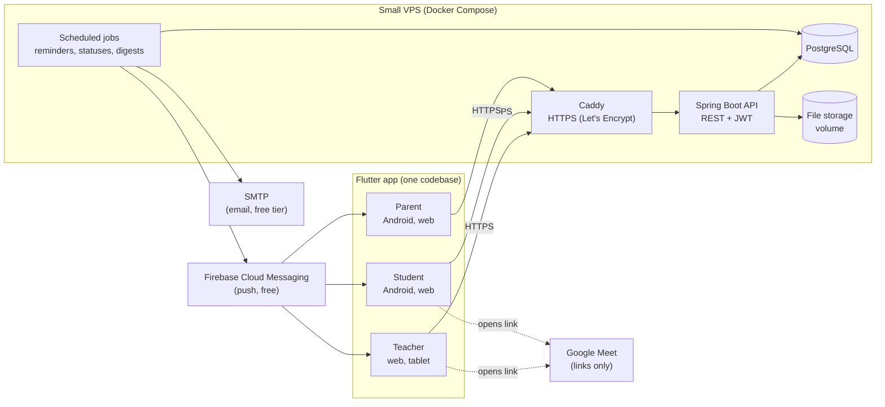

# Conception 01. Architecture

## System overview



## Stack decision

| Layer | Choice | Why |
|---|---|---|
| Client | **Flutter** (web + Android, iOS later) | one codebase for three roles and three platforms; required by the client spec |
| State | **Cubit** (flutter_bloc) | required by the client spec; simple and testable |
| Backend | **Spring Boot 3 + PostgreSQL 16** (recommended) | team's known stack, no vendor limits, scheduled jobs built in, predictable cost |
| Hosting | one small VPS with Docker Compose | about 5 to 8 € per month, see `04-delivery/02-COST.md` |
| Files | VPS volume behind a `StorageService` interface | free; can move to an S3-compatible bucket later without client changes |
| Push | Firebase Cloud Messaging | free |
| Email | SMTP (Gmail or a free transactional tier) | free within daily limits |
| HTTPS | Caddy with automatic Let's Encrypt | free |

### Fallback for a strict 0 € budget (Q11)

| Option | Pros | Cons |
|---|---|---|
| **A. Spring Boot + PostgreSQL on a VPS** (recommended) | no limits on usage, full control, known stack | about 5 to 8 € per month, server maintenance |
| B. Supabase free tier (Postgres, Auth, Storage, Edge Functions) | 0 €, managed, row-level security for roles | storage and database size limits, inactive projects can be paused (school holidays), vendor lock-in for auth and functions |

Both options use **PostgreSQL**, so the data model in `02-DATA_MODEL.md` is the same. The Flutter app talks to repositories, so only the `data/` layer changes between options.

## Flutter app

### One app, three shells
After login, the router reads the user's role and opens one of three shells:

| Shell | Layout | Navigation |
|---|---|---|
| `TeacherShell` | desktop first: side rail + content + optional side panel | Ma journée, Planning, Élèves, Contenus, Devoirs, Annonces, Paramètres |
| `StudentShell` | phone first: bottom bar | Accueil, Cours, Devoirs, Planning, Résultats |
| `ParentShell` | phone first: bottom bar + child switcher | Aperçu, Planning, Notifications |

Breakpoints: under 600 px phone, 600 to 1024 px tablet, over 1024 px desktop.

### Folder structure (from the client spec, expanded)

```text
lib/
├── core/                 # theme (brand colors, fonts), router, DI, l10n, errors, utils
├── data/
│   ├── dto/              # JSON models matching the API
│   ├── remote/           # Dio API clients, one per resource
│   └── repository/       # implementations of domain repositories
├── domain/
│   ├── model/            # pure Dart entities (Student, Session, Assignment...)
│   └── repositories/     # abstract repository interfaces
├── view/
│   ├── stateManager/     # Cubits and states, one folder per feature
│   ├── screens/
│   │   ├── teacher/
│   │   ├── student/
│   │   ├── parent/
│   │   └── shared/       # login, notifications, PDF viewer, settings
│   └── widgets/          # shared widgets: status chip, empty state, formula field...
└── main.dart
```

Rules: widgets never call Dio or repositories directly; Cubits call repositories; repositories map DTOs to domain models; business rules computed on the server are not recomputed in the app.

### Free packages (candidates)

| Need | Package |
|---|---|
| State | `flutter_bloc` |
| Routing, deep links | `go_router` |
| HTTP | `dio` |
| Secure token storage | `flutter_secure_storage` |
| Math rendering | `flutter_math_fork` |
| PDF generation and printing | `pdf`, `printing` |
| PDF viewing | `pdfrx` |
| Camera, files | `image_picker`, `file_picker` |
| Image compression | `image` |
| Calendar | `table_calendar` or a custom week view |
| Charts | `fl_chart` |
| Push | `firebase_messaging` |
| Open Meet links | `url_launcher` |
| Dates, French formats | `intl` |
| Launcher icons | `flutter_launcher_icons` (dev) |

Check each package's license and maintenance before adding it. No package with a paid license.

### Math input
No complete free WYSIWYG math editor exists for Flutter. The editor is a text field storing LaTeX, with a toolbar that inserts templates (`\frac{}{}`, `^{}`, `\sqrt{}`...) and a live preview rendered by `flutter_math_fork`. The same LaTeX is rendered in PDFs.

## Backend (Spring Boot)

```text
src/main/java/.../ngclass/
├── config/          # security, CORS, scheduling, storage, FCM, mail
├── auth/            # login, JWT access + refresh, password reset by teacher
├── people/          # users, students, parents, links
├── groups/          # groups, members, school years
├── planning/        # recurrence rules, sessions, attendance
├── content/         # chapters, content items, exercises, quizzes, files, shares
├── work/            # assignments, recipients, submissions, corrections, evaluations
├── progress/        # grade views, indicators, dashboard aggregates
├── comms/           # announcements, comments, notifications, devices, digests
└── common/          # errors, pagination, time, permissions
```

- **Spring Security** with JWT (short access token, refresh token), BCrypt passwords, login rate limit.
- **Permission layer**: every service method checks role and ownership (teacher, own student, parent of student).
- **Flyway** migrations; **Spring Data JPA**.
- **Scheduled jobs** (`@Scheduled`, every 5 minutes): switch statuses to `Manquant`, close timed quizzes, send reminders, build digests, respect quiet hours.
- **Storage**: files saved under random keys; downloads through short-lived signed URLs.
- **PDF**: generated in the Flutter app (works offline, no server load); the server only stores the result when saved to the library.

## Cross-cutting decisions
- All times stored in UTC, displayed in `Africa/Tunis`.
- All IDs are UUIDs.
- Soft delete (archive) for students, groups and content; hard delete only for drafts and unused records.
- Every list endpoint is paginated.
- API errors use one format: `{ code, message, details }` with French messages for the UI.
- Backups: nightly `pg_dump` and file sync to a second location, 30 days kept.
