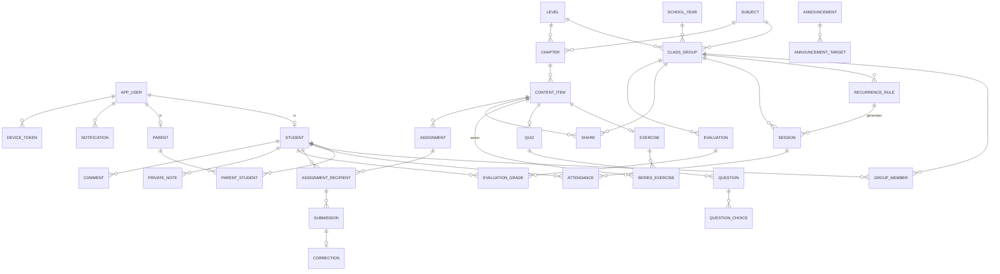

# Conception 02. Data model

PostgreSQL. All IDs are UUIDs, all timestamps are UTC (`timestamptz`). Every table has `created_at` and `updated_at` (omitted below).

## Entity relationship diagram

## Tables

### People

**users** (implemented, V1): `id`, `role` (TEACHER | STUDENT | PARENT), `username` (unique, lower case), `phone` (unique, 8 digits, nullable), `email` (nullable), `password_hash`, `first_name`, `last_name`, `language` (fr | ar), `active`, `must_change_password`, `failed_login_attempts`, `locked_until`, `last_login_at`. A unique partial index allows only one TEACHER.

**refresh_tokens** (implemented): `id`, `token_hash` (SHA-256), `user_id`, `expires_at` (365 days, extended on each refresh), `revoked`

**student**: `id`, `user_id`, `level_id`, `archived_at`

**parent**: `id`, `user_id`

**parent_student**: `parent_id`, `student_id`, `relation` (mère, père, tuteur). Max 2 parents per student (checked in service).

### Organization

**school_year**: `id`, `label` ("2026-2027"), `starts_on`, `ends_on`, `is_current`

**subjects** (implemented): `id`, `name_fr`, `name_ar`, `color`, `position`

**levels** (implemented): `id`, `name_fr`, `name_ar`, `position`

**class_group**: `id`, `school_year_id`, `subject_id`, `level_id`, `name`, `is_private`, `default_meet_url`, `color`, `archived_at`

**group_member**: `group_id`, `student_id`, `joined_at`, `left_at`

### Planning

**recurrence_rule**: `id`, `group_id`, `weekday` (1-7), `start_time`, `end_time`, `mode` (in_person | online), `location`, `meet_url`, `starts_on`, `ends_on`

**session**: `id`, `group_id`, `recurrence_rule_id` (nullable), `starts_at`, `ends_at`, `mode`, `location`, `meet_url` (nullable, falls back to group), `status` (planned | in_progress | done | cancelled), `cancel_reason`, `prep_note` (private), `session_note` (private), `quick_note` (private), `is_exception` (edited apart from its rule)

**session_coverage**: `session_id`, `chapter_id` (nullable), `content_item_id` (nullable)

**attendance**: `session_id`, `student_id`, `status` (present | absent | late), `marked_at`. Primary key (`session_id`, `student_id`).

### Content

**chapter**: `id`, `subject_id`, `level_id`, `title`, `position`, `archived_at`

**content_item**: `id`, `type` (lesson | document | exercise | series | quiz | worksheet), `title`, `chapter_id` (nullable), `status` (draft | published | archived), `difficulty` (easy | medium | hard, nullable), `tag` (série | cours | corrigé | autre, documents only), `body` (JSON: rich text with LaTeX, lessons), `duplicated_from_id`, `ai_generated` (later)

**file_asset**: `id`, `storage_key`, `mime_type`, `size_bytes`, `original_name`, `page_count`, `uploaded_by`. Referenced by documents, exercises, questions, submissions and corrections.

**content_file**: `content_item_id`, `file_id`, `position` (documents and lesson attachments)

**exercise**: `content_item_id`, `statement` (LaTeX text), `image_file_id`, `points`, `expected_answer`, `model_answer` (LaTeX text), `model_answer_file_id`

**series_exercise**: `series_id` (content_item), `exercise_id` (content_item), `position`

**quiz**: `content_item_id`, `time_limit_min` (nullable), `attempts_allowed`, `score_policy` (best | last), `answers_shown` (after_submit | after_deadline | never), `shuffle`, `mcq_only`, `locked_at`

**question**: `id`, `quiz_id`, `position`, `type` (mcq | true_false | short | blanks | open), `text`, `image_file_id`, `points`, `explanation`, `accepted_answers` (JSON: list for short, list per blank for blanks, boolean for true_false)

**question_choice**: `id`, `question_id`, `position`, `text`, `is_correct`

**worksheet_item**: `worksheet_id` (content_item), `exercise_id` or `question_id`, `position`

**share**: `id`, `group_id`, `content_item_id` or `chapter_id`, `shared_at`

### Work

**assignment**: `id`, `content_item_id`, `title`, `instructions`, `deadline_at`, `max_score`, `submission_mode` (file | online | none), `allow_late`, `closed_at`, `created_from_session_id` (nullable)

**assignment_target**: `assignment_id`, `group_id` or `student_id` (what the teacher chose)

**assignment_recipient**: `id`, `assignment_id`, `student_id`, `status` (todo | submitted | late | missing | corrected), `status_changed_at`. One row per student, created when assigned and when a student joins a target group before the deadline.

**submission**: `id`, `recipient_id`, `attempt_no`, `started_at`, `submitted_at`, `is_late`, `answers` (JSON, quizzes), `auto_score`, `needs_manual` (open questions or file)

**submission_file**: `submission_id`, `file_id`, `position`

**correction**: `id`, `submission_id`, `score`, `max_score`, `question_scores` (JSON, quizzes), `comment`, `file_id`, `corrected_at`

**evaluation**: `id`, `group_id`, `chapter_id` (nullable), `title`, `date`, `max_score`

**evaluation_grade**: `evaluation_id`, `student_id`, `score` (nullable), `absent`, `comment`

**grade_view** (SQL view): one row per grade from `correction` (latest attempt per policy) and `evaluation_grade` (not absent), with `student_id`, `subject_id`, `date`, `score`, `max_score`, `score_20`, `source`, `source_id`.

### Notes and communication

**private_note**: `id`, `student_id` or `session_id`, `body`. Teacher only.

**comment**: `id`, `student_id`, `submission_id` (nullable), `body`. Visible to the student and parents.

**announcement**: `id`, `title`, `body`, `audience` (students | parents | both), `sent_at`

**announcement_target**: `announcement_id`, `group_id` or `student_id`

**announcement_read**: `announcement_id`, `user_id`, `read_at`

**notification**: `id`, `user_id`, `type`, `title`, `body`, `link` (deep link), `payload` (JSON), `read_at`, `push_status` (none | queued | sent | failed), `send_after` (quiet hours)

**device_token**: `id`, `user_id`, `token`, `platform` (android | web | ios), `last_seen_at`

**notification_preference**: `user_id`, `category`, `muted`

**setting** (key/value for the teacher): attention thresholds, digest time, quiet hours, AI enabled (later), PDF header details.

## Key indexes
- `session (group_id, starts_at)`, `session (starts_at)` for today/tomorrow queries
- `attendance (student_id)`
- `assignment_recipient (student_id, status)`, `assignment_recipient (assignment_id)`
- `assignment (deadline_at)` for the scheduled status job
- `submission (recipient_id)`, partial index on submissions waiting for correction
- `notification (user_id, read_at)`, `notification (send_after) where push_status = 'queued'`
- trigram or unaccent index on `content_item.title` for search
