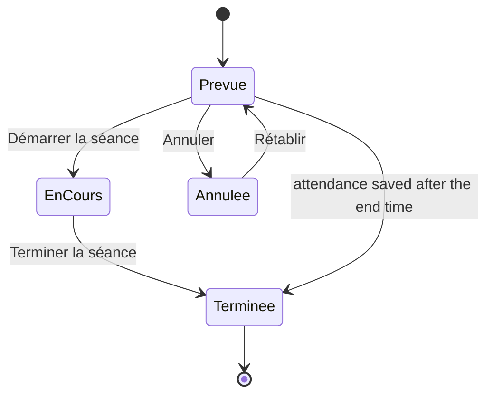
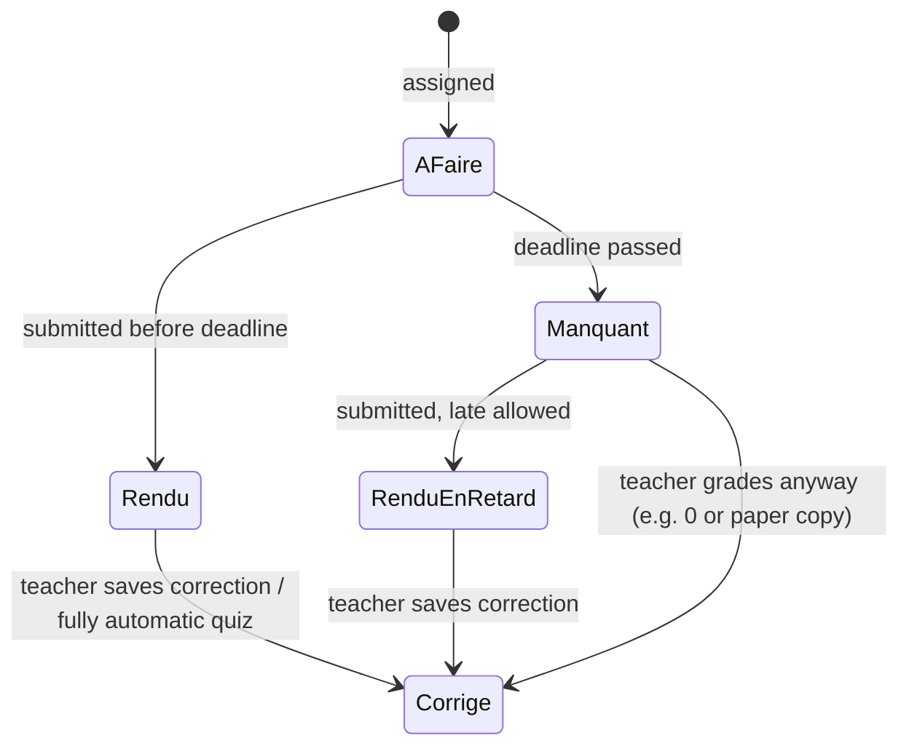

# Conception 03. Business rules

Rules computed on the server, used the same way by every screen.

## 1. Session status

- A session still `Prévue` 24 hours after its end without attendance stays `Prévue` and shows "Présences non saisies" on the teacher home.
- Cancelled sessions do not count in attendance statistics.

## 2. Recurring sessions
- Sessions are generated from the rule up to its end date (one school year at most).
- "This session only": the session gets `is_exception = true` and is never overwritten by its rule again.
- "This and following": the current rule ends the day before, a new rule starts from this session; future non-exception sessions are regenerated; past sessions are never touched.
- Deleting a rule cancels its future sessions that have no attendance.

## 3. Assignment recipient status

- The status job runs every 5 minutes and switches `À faire` to `Manquant` once `deadline_at` has passed.
- Changing the deadline to a later date moves `Manquant` back to `À faire`.
- Re-submitting before correction replaces the previous files; the status stays `Rendu`.
- `Aucun` mode assignments have no recipient status.

## 4. Quiz scoring
- Multiple choice and true/false: full points if correct, 0 otherwise (no negative marking).
- Short answer: full points if the normalized answer matches one accepted answer.
- Fill in the blank: question points divided equally between blanks, rounded to 0.25.
- Normalization: lower case, accents removed, spaces trimmed and collapsed, final full stop removed, decimal comma turned into a dot.
- Open questions: scored by the teacher; until then the submission shows the partial automatic score and is in the correction queue.
- Several attempts: the grade kept follows `score_policy` (default: best).
- Timer: the server stores `started_at`; a submission received after `started_at + time_limit` (plus 30 seconds of tolerance) is closed with the answers saved so far.

## 5. Grades and averages
- `score_20 = score / max_score × 20`, rounded to 2 decimals, displayed with a decimal comma (15,25).
- **Subject average** = mean of `score_20` of all grades of the student in that subject for the school year. No coefficients (Q6).
- Evaluation `Absent` and assignments not yet corrected are excluded.
- `Manquant` assignments are **not** counted as 0 in the average automatically; the teacher can grade them 0 explicitly.
- **Trend**: compare the mean of the last 3 grades with the mean of the grades before them; up if ≥ +1, down if ≤ -1, stable otherwise. Needs at least 4 grades.

## 6. Completion
- Assignments due = recipient rows in `file` or `online` mode whose deadline has passed, plus those already submitted.
- `Completion % = (Rendu + Rendu en retard + Corrigé with a submission) / assignments due × 100`.
- Shown as "3 rendus sur 4".

## 7. Attendance
- Sessions counted = sessions `Terminée` of the student's groups, while the student was a member, with an attendance row.
- `Attendance % = (Présent + En retard) / sessions counted × 100`.
- Absences and late arrivals are also shown as counts.

## 8. Students needing attention
Defaults stored in settings, evaluated nightly and after each relevant change:
- `missing_count_30d ≥ 2`
- `absences_in_last_5_sessions ≥ 2`
- `mean(last 3 grades) ≤ mean(previous grades) - 3`, per subject, with at least 4 grades
A student leaves the list when no rule matches anymore.

## 9. Visibility
A student can read a content item if at least one is true:
- it is `Publié` and shared with one of their active groups (directly or through its chapter)
- it is the content of an assignment they receive

Model answers (exercise corrigés, quiz correct answers) are visible to a student only:
- after the assignment deadline (default), or right after submission, as set on the quiz
- never for `answers_shown = never`

Parents see the indicators, statuses, grades and comments of their children, never the content itself.

## 10. Archive and delete
- Students, groups, chapters and content items are archived, never hard deleted, once they have history.
- Hard delete allowed for: draft content never assigned, sessions with no attendance, announcements not yet read.
- Archived content stays readable from the assignments that used it.

## 11. School year rollover
- At the end of a school year, the teacher creates the new year and its groups (option: copy groups and rules from last year).
- Old groups are archived; students move to their new level (bulk "Passage au niveau supérieur").
- Indicators default to the current year; past years remain visible in profiles.

## 12. Notifications
- Quiet hours 21:00 to 07:00 (Africa/Tunis): push queued with `send_after = 07:00`, except session reminders for sessions starting before 07:30.
- At most one reminder per assignment per student per day.
- Events of the same type for the same user within 10 minutes are merged into one push.
- Muted categories still appear in the in-app notification center.
