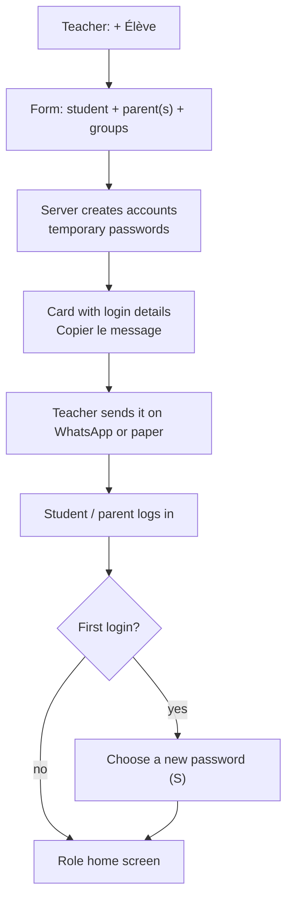
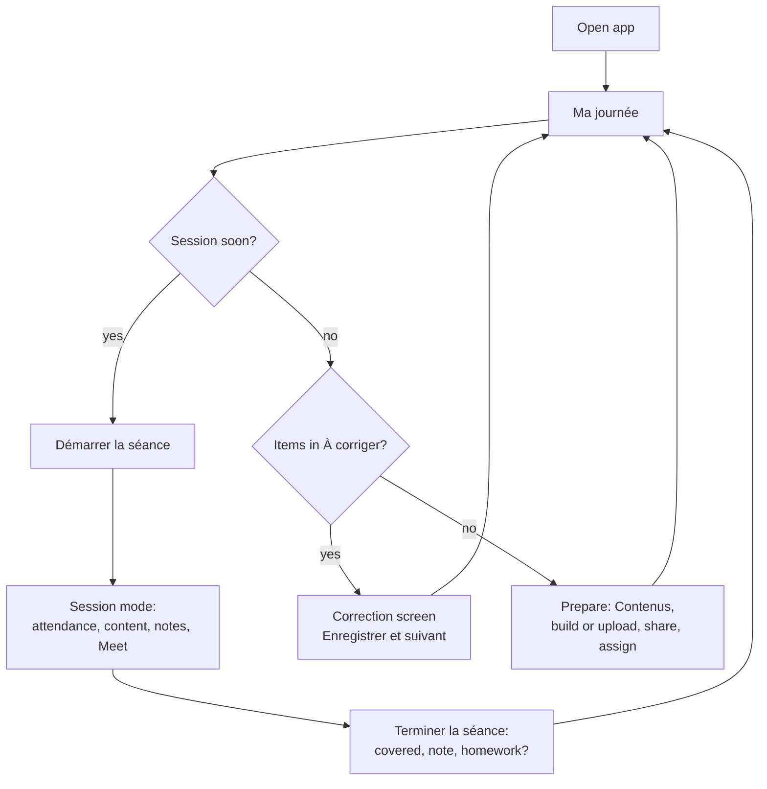
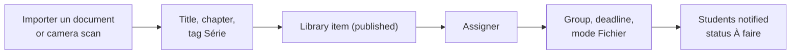
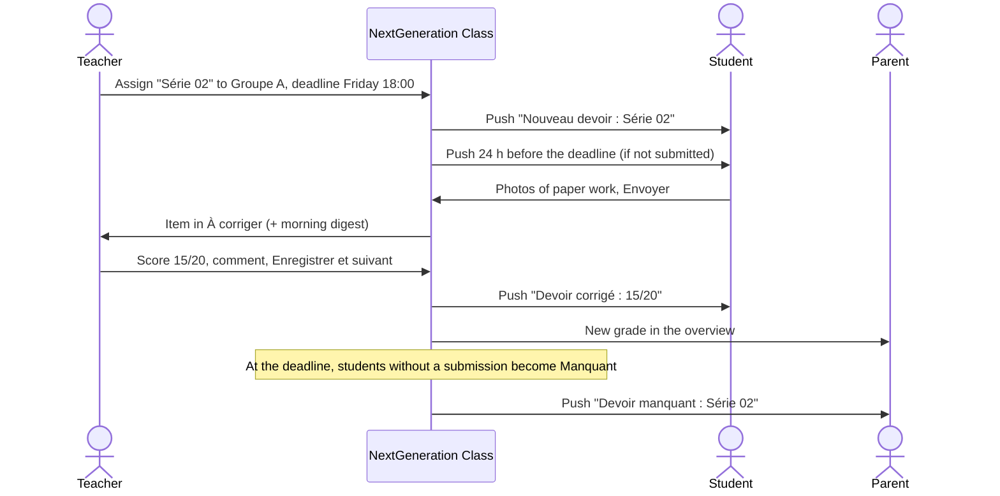
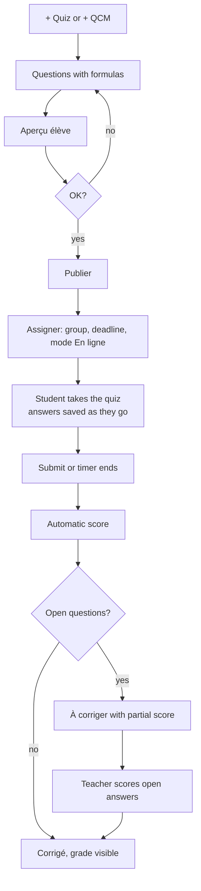
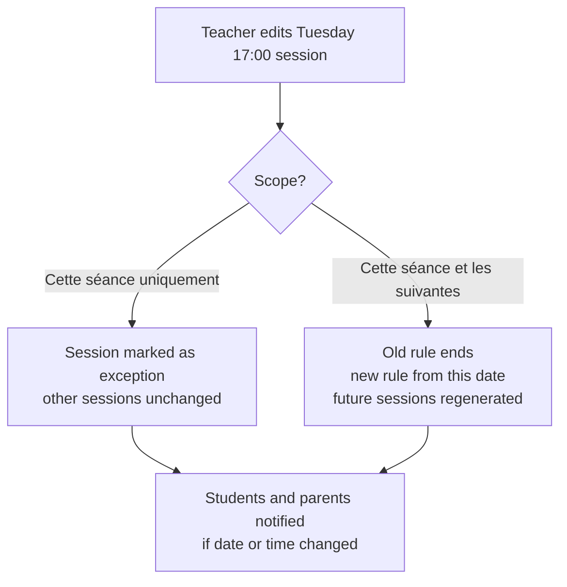
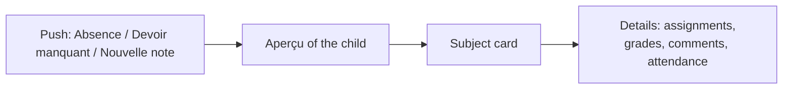

# Conception 04. User flows

## 1. Onboarding a student and their parent

## 2. The teacher's day

## 3. Upload an existing series and assign it

## 4. Assignment lifecycle

## 5. Quiz: build, assign, take, correct

## 6. Recurring session change

## 7. Parent check

